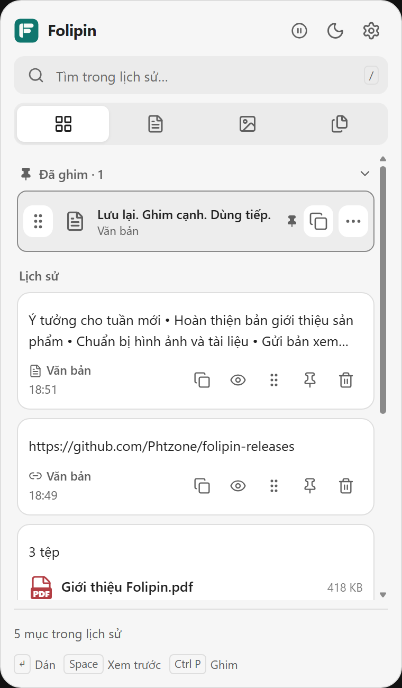
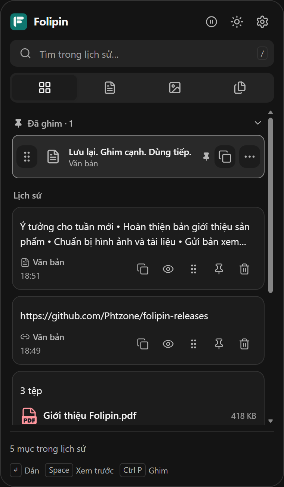
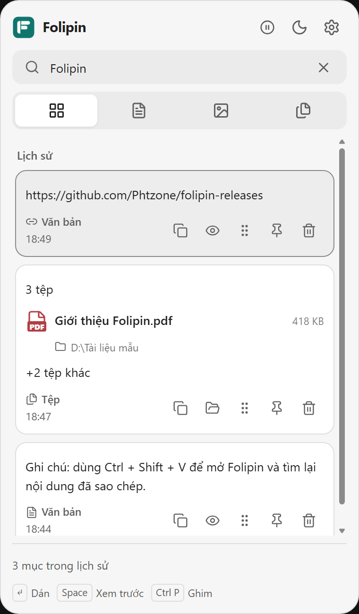
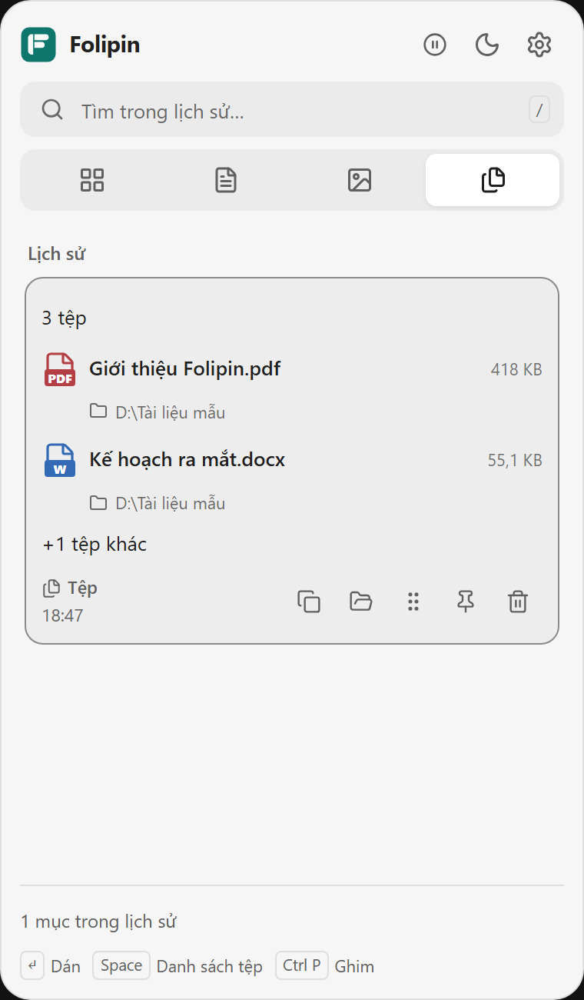
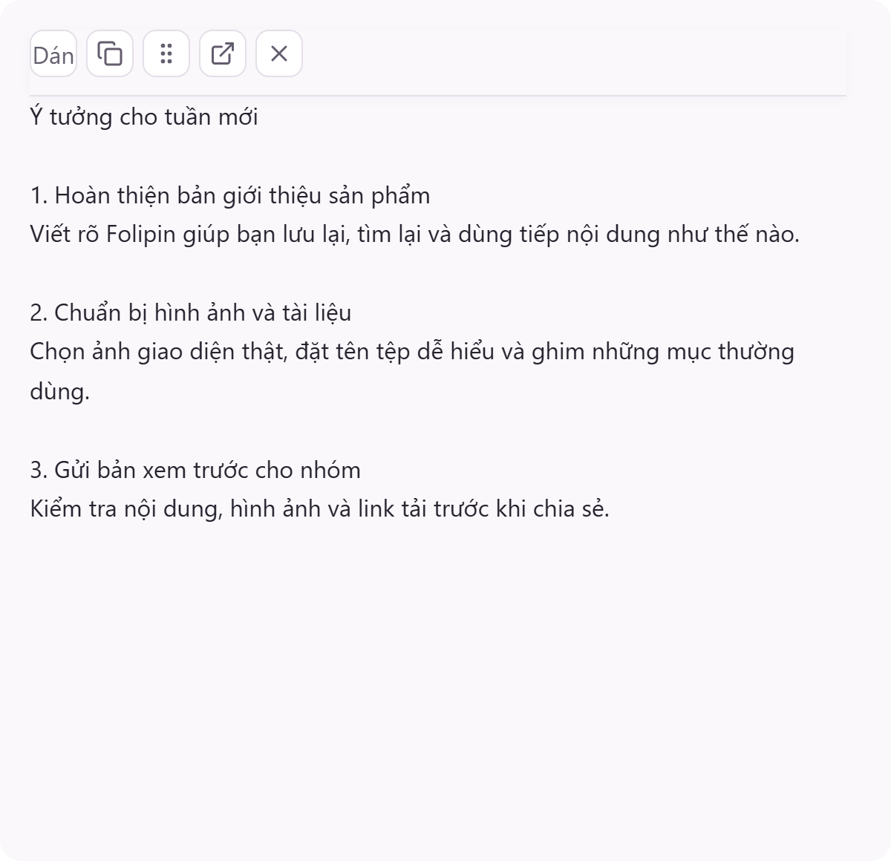
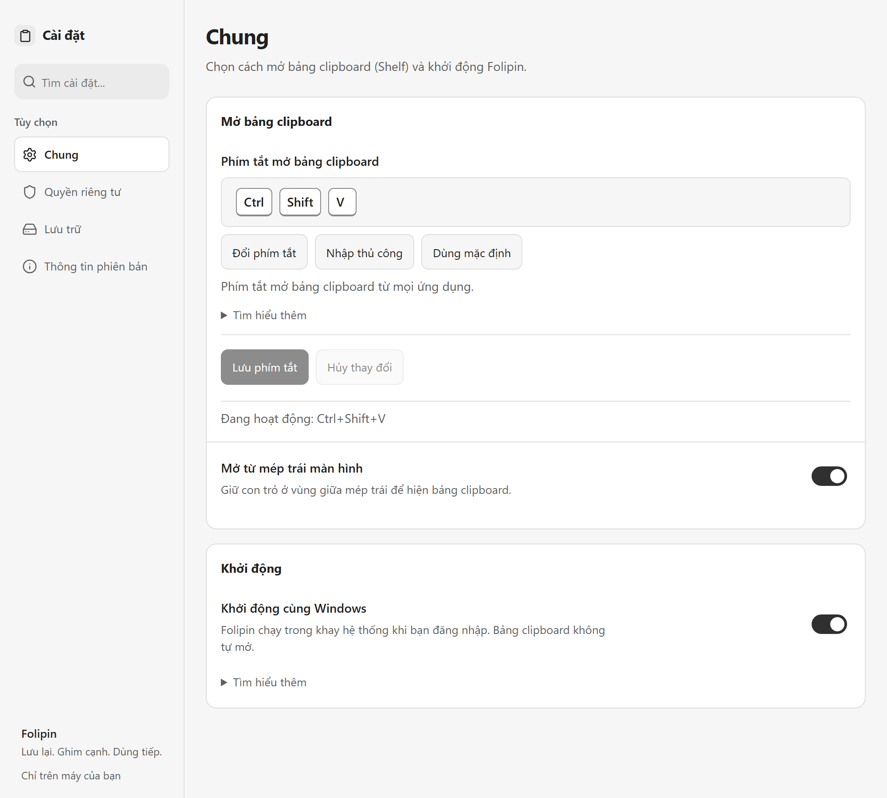

  

<h1 align="center">Folipin</h1>

<strong>Lưu lại. Ghim cạnh. Dùng tiếp.</strong>

Không gian clipboard cho Windows — giữ nội dung cần dùng ngay trong tầm tay.

  

  Windows 10/11 · x64 · Lịch sử lưu trên máy 
  <a href="https://github.com/Phtzone/folipin-releases/releases">Lịch sử cập nhật</a> ·
  <a href="https://github.com/Phtzone/folipin-releases/issues/new">Báo lỗi &amp; góp ý</a>

---

## Sao chép một lần, dùng lại khi cần

Đang viết tài liệu, gom hình ảnh hay chuyển tệp giữa các ứng dụng? Folipin giữ lại nội dung đã sao chép để bạn tìm lại, xem trước và dùng tiếp. Ghim những mục thường dùng, tìm nhanh bằng từ khóa và mở bảng clipboard từ mép trái màn hình hoặc phím tắt **Ctrl + Shift + V**.

<table>
  <tr>
    <td align="center" width="50%"> Những nội dung cần dùng, trong cùng một bảng.</td>
    <td align="center" width="50%"> Chuyển nhanh giữa giao diện sáng và tối.</td>
  </tr>
</table>

Ảnh được chụp từ các thành phần giao diện Folipin với dữ liệu mẫu, không sử dụng lịch sử clipboard cá nhân. Nội dung và thời gian trong ảnh chỉ dùng để minh họa.

## Những việc Folipin giúp bạn làm nhanh hơn

### Giữ lại và ghim nội dung quan trọng

Lưu lịch sử văn bản, hình ảnh, nội dung có định dạng và tham chiếu tệp đã sao chép. Ghim những mục cần dùng nhiều lần ở đầu bảng; đặt tên và sắp xếp mục ghim để dễ nhận ra. Khi bảng thu vào rồi hiện lại, Folipin đưa bạn về **Tất cả** và đầu lịch sử mới nhất.

### Tìm đúng nội dung, bớt cuộn lịch sử

Nhập từ khóa để tìm trong lịch sử hoặc chuyển bộ lọc **Tất cả · Văn bản · Hình ảnh · Tệp**. Có thể tìm theo tên tệp và dùng các phím mũi tên để chọn kết quả.

### Làm việc với cả nhóm tệp

Xem tên, loại và dung lượng của các tệp đã sao chép; mở thư mục chứa tệp hoặc kéo nội dung sang ứng dụng khác khi được hỗ trợ. Các tệp trong cùng lần sao chép được hiển thị chung để dễ theo dõi.

<table>
  <tr>
    <td align="center" width="50%"> Tìm lại văn bản và tệp bằng từ khóa.</td>
    <td align="center" width="50%"> Nhóm tệp hiển thị tên, loại và dung lượng.</td>
  </tr>
</table>

### Xem trước rồi dùng tiếp

Đọc nội dung văn bản, xem ảnh và xem trước các loại tài liệu được hỗ trợ, bao gồm PDF, ngay trong cửa sổ xem trước. Bạn có thể sao chép lại hoặc ghim cửa sổ lên màn hình để tham khảo trong lúc làm việc.

### Điều chỉnh theo cách bạn làm việc

Đổi phím tắt, bật mở từ mép màn hình, chọn khởi động cùng Windows và chuyển giao diện sáng/tối. Cài đặt cũng có các trang **Quyền riêng tư**, **Lưu trữ** và **Thông tin phiên bản** để quản lý ứng dụng tại một nơi.

## Bắt đầu trong vài bước

1. [Tải bộ cài mới nhất](https://github.com/Phtzone/folipin-releases/releases/latest/download/Folipin_0.1.1_x64-setup.exe) và chạy tệp `.exe`.
2. Mở Folipin rồi sao chép văn bản, ảnh hoặc tệp như bình thường.
3. Nhấn **Ctrl + Shift + V**, hoặc đưa con trỏ tới vùng giữa mép trái màn hình nếu tính năng này đang bật.
4. Chọn nội dung để xem trước; nhấn **Enter** hoặc nhấp đúp để dán vào ứng dụng đang làm việc.

Nếu chưa thấy bảng clipboard, tìm biểu tượng Folipin ở khay hệ thống cạnh đồng hồ Windows. File chương trình sau khi cài có tên **Folipin.exe**.

**Yêu cầu:** Windows 10/11, bộ xử lý x64 và Microsoft Edge WebView2 Runtime. Chỉ tải tệp `Folipin_<phiên-bản>_x64-setup.exe`; các tệp `.sig`, `latest.json` và mục **Source code** trên GitHub không phải bộ cài để mở thủ công.

### Phím tắt thường dùng

| Phím | Thao tác |
| --- | --- |
| **Ctrl + Shift + V** | Mở bảng clipboard; có thể đổi trong Cài đặt |
| **↑ / ↓** | Di chuyển giữa các mục |
| **Enter** | Dán mục đang chọn |
| **Space** | Xem trước mục đang chọn |
| **Ctrl + P** | Ghim hoặc bỏ ghim mục đang chọn |
| **/** | Chuyển tới ô tìm kiếm |
| **Esc** | Quay lại hoặc đóng theo ngữ cảnh |

## Dữ liệu nằm trên máy của bạn

Lịch sử clipboard được lưu cục bộ. Bạn có thể tạm dừng lưu từ đầu bảng, loại trừ ứng dụng trong **Cài đặt → Quyền riêng tư**, và quản lý lịch sử trong **Cài đặt → Lưu trữ**.

**Với mục tệp, Folipin lưu tham chiếu đến tệp gốc.** Ghim mục tệp không tạo bản sao lưu; nếu tệp nguồn bị di chuyển hoặc xóa, thao tác mở và sử dụng lại có thể không còn khả dụng.

## Cập nhật Folipin

Vào **Cài đặt → Thông tin phiên bản → Kiểm tra cập nhật**. Đọc nội dung thay đổi rồi chọn tải và cài khi sẵn sàng. Gói cập nhật được kiểm tra chữ ký trước khi cài; ứng dụng sẽ đóng trong quá trình nâng cấp.

**Đang dùng 0.1.1?** Bộ cài hiện tại được làm mới nhưng giữ nguyên số phiên bản. Hãy thoát Folipin rồi [tải bộ cài và cài đè](https://github.com/Phtzone/folipin-releases/releases/latest/download/Folipin_0.1.1_x64-setup.exe) để nhận các thay đổi mới; updater sẽ không thông báo bản mới có cùng số phiên bản. Không cần gỡ ứng dụng hoặc xóa lịch sử.

Nếu bản đang dùng chưa có updater hoặc kiểm tra cập nhật thất bại, tải bộ cài tại [GitHub Releases](https://github.com/Phtzone/folipin-releases/releases/latest).

## Góp ý để Folipin tốt hơn

[Tạo issue](https://github.com/Phtzone/folipin-releases/issues/new) với phiên bản Folipin, phiên bản Windows, các bước tái hiện và kết quả mong đợi. Ảnh chụp hoặc video minh họa sẽ giúp mô tả vấn đề rõ hơn.

**Issues là công khai:** hãy che thông tin cá nhân và nội dung clipboard nhạy cảm trước khi gửi.

---

Kho này phân phối bộ cài và bản cập nhật chính thức của **Folipin**. Mã nguồn ứng dụng được quản lý riêng.
